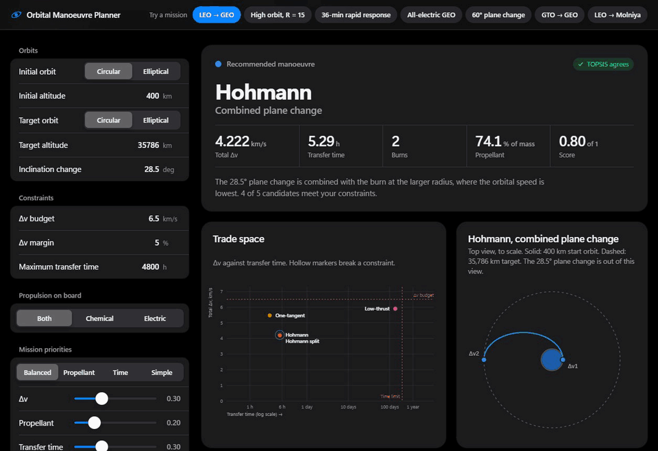
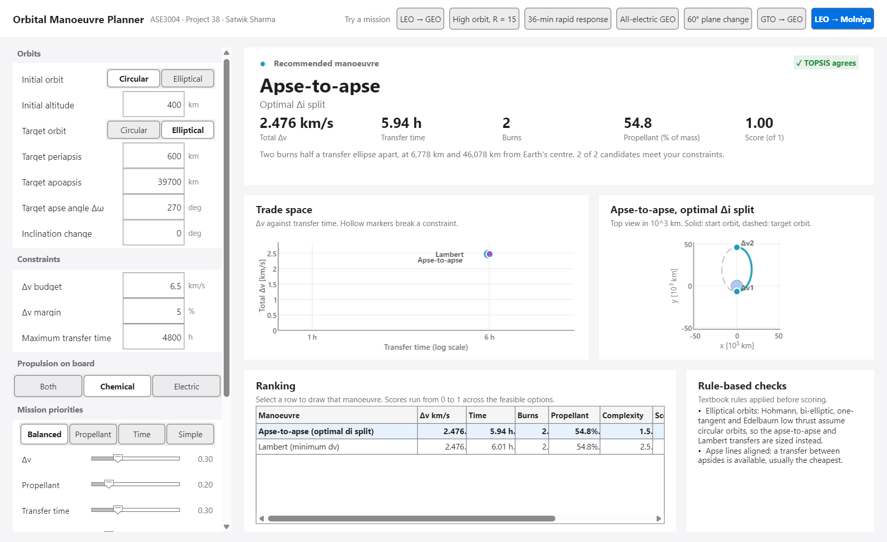
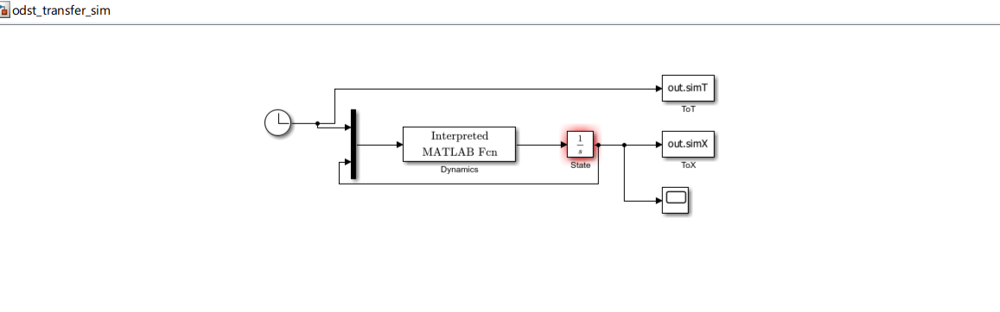
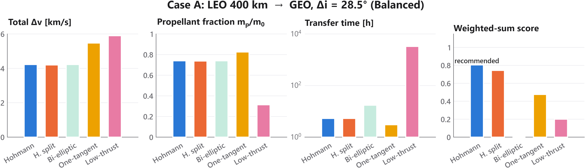
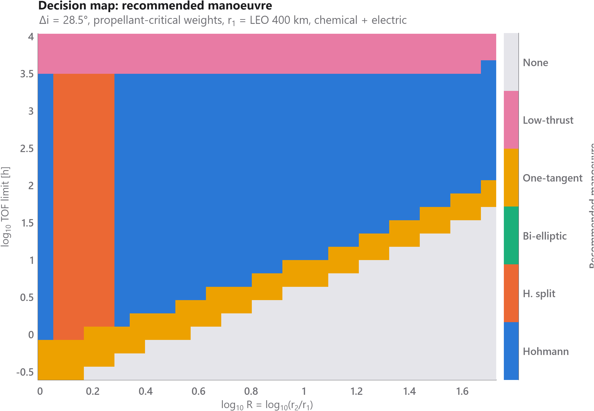
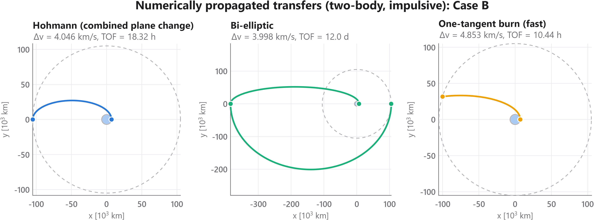
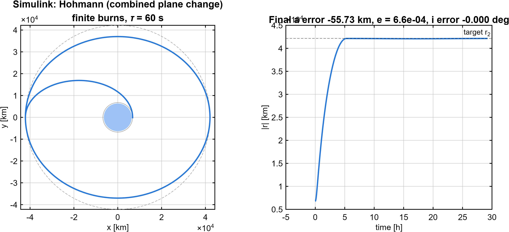

# Orbital Manoeuvre Decision Support Tool

[](https://github.com/satwiksharma01/orbital-manoeuvre-decision-support/actions/workflows/tests.yml)

**Which manoeuvre should a mission fly?** A decision-support tool that sizes the candidate orbital transfers, optimises each one numerically, removes those that break the mission's constraints and ranks the rest by the mission's priorities. Five transfers between circular orbits; apse-to-apse and Lambert transfers when either orbit is elliptical. Built in MATLAB and Simulink, cross-checked in Python and NASA GMAT, with an interactive web planner.



**[Try the live demo](https://satwiksharma01.github.io/orbital-manoeuvre-decision-support/web/)**

## What it does

Given an initial and a target orbit (circular, or elliptical with a periapsis and an apoapsis, plus the target's apse angle Δω), an inclination change, a Δv budget, a time limit, the propulsion on board and the mission's priorities, the tool:

1. **Models the candidates.** Between circular orbits: Hohmann, Hohmann with an optimised plane-change split, bi-elliptic, one-tangent burn and an Edelbaum low-thrust spiral. When either orbit is elliptical: an apse-to-apse transfer with an optimised plane-change split, and the minimum-Δv two-burn Lambert transfer.
2. **Optimises each one:** the plane-change split (`fminbnd`), the bi-elliptic apoapsis under a time limit (grid search + `fminbnd` + `fzero`), the cheapest fast transfer that meets a deadline (`fzero`), and the Lambert transfer over departure point, arrival point and flight time (a universal-variable Lambert solver inside a grid search, golden section and Nelder–Mead). Lambert arcs are kept at least 100 km above the surface.
3. **Applies rules:** hard constraints (Δv plus a finite-burn gravity-loss estimate and a margin, default 5 %, time, propulsion) plus textbook rules such as the 11.94 / 15.58 Hohmann vs bi-elliptic thresholds for coplanar transfers. The propellant fraction includes the gravity loss.
4. **Ranks the survivors:** weighted-sum scoring cross-checked with TOPSIS, with presets for balanced, propellant-critical, time-critical and low-complexity missions.

## Results

| Mission | Recommendation | Why |
|---|---|---|
| LEO 400 km → GEO, Δi = 28.5° | Hohmann, 4.22 km/s, 5.3 h | Optimal split saves only 25 m/s; stays first until the time weight exceeds 0.86 |
| Same, propellant-critical, 1-year limit | Low-thrust spiral | Propellant fraction 0.31 instead of 0.74 |
| 7 000 → 105 000 km (R = 15) | Hohmann | Bi-elliptic saves 1.2 % Δv but takes 12 days instead of 18 hours |
| 400 → 800 km within 36 min | One-tangent, k* = 1.0098 | Hohmann takes 48 min; root-finding gives the cheapest transfer that arrives in time |
| GTO 250 × 35 786 km → GEO, Δi = 28.5° | Apse-to-apse: one apogee burn, 1.833 km/s | The burn at apogee both circularises and turns the plane. The Lambert search finds the same 1.833 km/s by coasting to apogee first; NASA GMAT's own targeting agrees to 0.05 mm/s |
| LEO 400 km → a Molniya-sized 600 × 39 700 km orbit, Δω = 270° (in the start plane) | Apse-to-apse, 2.476 km/s, 5.9 h | From a circular orbit, any point can be the transfer's perigee. Lambert comes within 1.5 mm/s of it, so the simpler two-burn transfer wins |
| 500 × 5 000 → 800 × 12 000 km, apse lines 60° apart, Δi = 10° | Lambert, 1.859 km/s, 1.0 h | Two elliptical orbits with apse lines 60° apart rule out apse-to-apse; only the Lambert transfer is offered |

## Verification

- Textbook benchmarks (Hohmann LEO→GEO 3.893 km/s, the 11.94 bi-elliptic threshold, plane-change limits).
- Every burn plan propagated with `ode45`: final orbit within 0.5 km, e < 10⁻⁹, Δv matches the model to 10⁻⁵ km/s.
- **Simulink** finite-burn model: the error grows as τ², about 56 km at τ = 60 s for LEO→GEO, so the impulsive model holds for short chemical burns.
- An independent Python implementation and a Node test of the web engine agree with MATLAB to every printed digit.
- **NASA GMAT R2026a**: GMAT's differential corrector, flying the same LEO 400 km → GEO transfers, matches the tool to under 1 mm/s and 0.01 s (4.22154 km/s and 5.2913 h with Δi = 28.5°; 3.85396 km/s coplanar). Adding J2 in GMAT costs 2.4 m/s more and 1.1 s. Script in `gmat/`, runner `python/gmat_crosscheck.py` (needs a local GMAT, so not in CI).
- **Elliptical orbits and Lambert:**
  - The Lambert solver reproduces Curtis, Example 5.2, to 10⁻⁴ km/s, and its departure velocity, propagated for the hour, reaches the target position within 10⁻⁶ km.
  - Apse-to-apse between circular orbits equals Hohmann with the optimal split to 10⁻⁹ km/s.
  - Python, MATLAB and the web engine run the same algorithms and agree on four elliptical test missions: Δv to 5 × 10⁻¹⁰ km/s and the same recommendation.
  - Every elliptical burn plan, propagated, arrives on its target orbit with angular-momentum and eccentricity-vector errors around 10⁻¹¹.
  - In GMAT, the differential corrector solves the GTO → GEO apogee burn itself (1.83334 km/s, within 0.05 mm/s of the tool). GMAT also flies all six elliptical burn plans, including a 3D Lambert transfer, and every arrival matches the target orbit to 3 × 10⁻⁹. That residual is GMAT's slightly different Earth μ.
- **Independent audit (2026-10-22)**, with methods unlike the engines' own:
  - The Lambert solver matches a shooting solution (numerical propagation plus root-finding) on 60 random 3D transfers, short and long way, elliptic and hyperbolic, to 2 × 10⁻¹⁰ km/s.
  - **Ground clearance:** without a check, 7 of 120 time-limited missions between low-perigee orbits produced Lambert "optima" that passed up to 609 km *below* the surface. Every Lambert arc must now stay above 100 km altitude. The floor is an exact penalty, because a hard wall stopped the search short of the boundary (46 m/s high). On a case where the floor is active, the result matches the global optimum from differential evolution to 0.4 mm/s and sits on the floor.
  - The Lambert optimiser reaches the global minimum found by differential evolution on eight missions; on the hardest it beats it by 4 m/s. Transfers in the opposite direction, searched separately for plane changes up to 170°, are never cheaper.
  - Edelbaum's closed form matches its averaged equations integrated numerically with Edelbaum's yaw law: speed to 10⁻⁸ km/s, plane change to 10⁻⁶° (now a permanent test).
  - The gravity-loss estimate stays within 3 % of a numerical finite burn at the perigee of eccentric orbits, not only from circular ones.
  - 271 random missions give the same options, feasibility and recommendation in all three engines; Δv differs by at most 4 × 10⁻⁸ km/s.

| MATLAB GUI | Simulink model |
|---|---|
|  |  |






## Scope and limitations

This is an early trade-study and teaching tool: it tells you which family of transfer to fly, roughly what Δv it costs and roughly how long it takes. It is not a mission-analysis or operations tool. It assumes:

| Assumption | What it leaves out |
|---|---|
| Elliptical orbits get two models | Hohmann, bi-elliptic, one-tangent and low thrust are sized only between circular orbits. Elliptical missions get apse-to-apse and Lambert |
| The plane change turns about the start orbit's apse line | A different node line (a RAAN difference) can't be entered |
| Lambert is single-revolution and starts at once | Multi-revolution transfers, and waiting or phasing time before departure |
| The Lambert search is a grid plus local refinement, not a proof of the global optimum | With no time limit it matched differential evolution on every audit mission. With a binding time limit between low-perigee orbits it landed up to 7 m/s (0.35 %) above the best transfer found, in 3 of 12 hard cases |
| Apse-to-apse needs aligned apse lines | If both orbits are elliptical and their apse lines aren't 0° or 180° apart, or a plane change would need a burn off the node line, only Lambert is offered; there is no three-burn nodal transfer |
| Two-body gravity | J2 (2.4 m/s on LEO → GEO in GMAT, but RAAN drifts by degrees a day in LEO, which matters for long spirals) and drag below about 500 km |
| Burns are impulsive, with a gravity-loss estimate | The loss uses Robbins' approximation from the thrust-to-weight input (default 0.5). It matches a fixed-attitude finite burn within 5 % for T/W ≥ 0.2, overestimates a velocity-tracking burn about 2×, and underestimates below T/W ≈ 0.1 |
| Burn timing is ignored | Phasing, rendezvous and launch windows |
| Low thrust is Edelbaum at constant acceleration | Power limits, eclipses and acceleration rising as propellant is used. The closed form holds only up to Δi = 114.6° (2 rad), so low thrust isn't offered for larger plane changes |
| A fixed Δv margin (default 5 %) | Uncertainty in Isp, thrust and pointing |
| Weights are chosen by the user | Only the time weight is swept; other weights can flip the ranking |

Within these assumptions the results match NASA GMAT (see Verification).

## Run it

**MATLAB** (R2021a+, Simulink optional), from the `matlab` folder:

```matlab
odst_tests   % validation suite
odst_main    % case studies, figures (matlab/results) and the Simulink check
odst_app     % interactive planner
```

**Web:** open `web/index.html` in any browser. No build step and no dependencies.

**Python** (3.10+, `numpy scipy matplotlib`):

```bash
python python/validate.py        # cross-check
node web/test_engine.js          # web engine regression test
python python/gmat_crosscheck.py # cross-check against a local NASA GMAT install
```

## Repository layout

| Path | Contents |
|---|---|
| `matlab/` | Models, optimisers, decision pipeline (`odst_evaluate.m`), GUI, Simulink model and builder, tests |
| `python/` | Reference implementation, validation and figure scripts |
| `web/` | Self-contained web planner and its engine test |
| `gmat/` | GMAT script for the cross-check, filled in and run by `python/gmat_crosscheck.py` |
| `assets/` | Screenshots and result figures used in this README |
