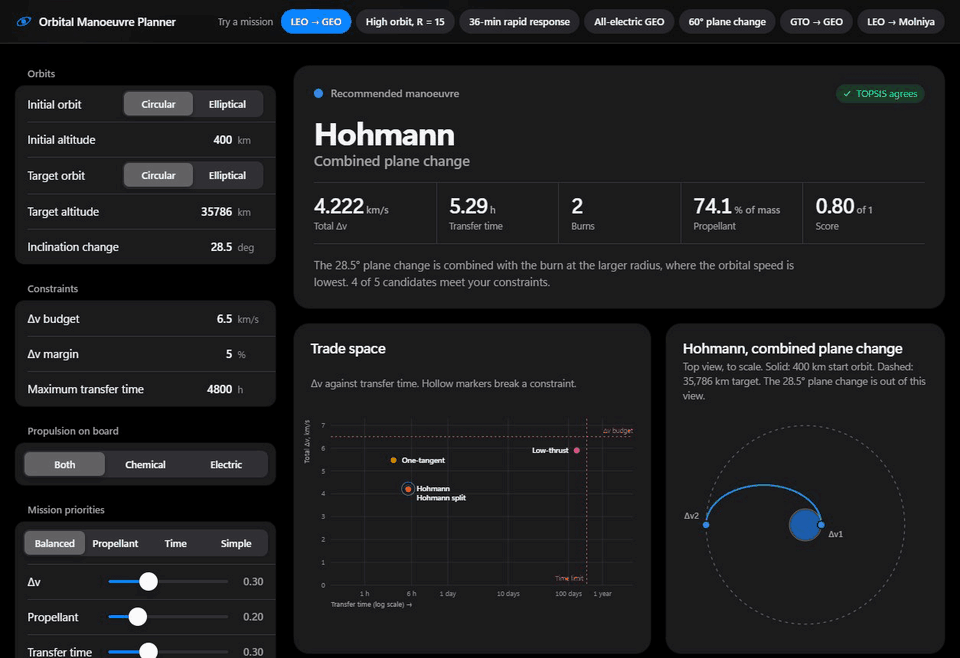
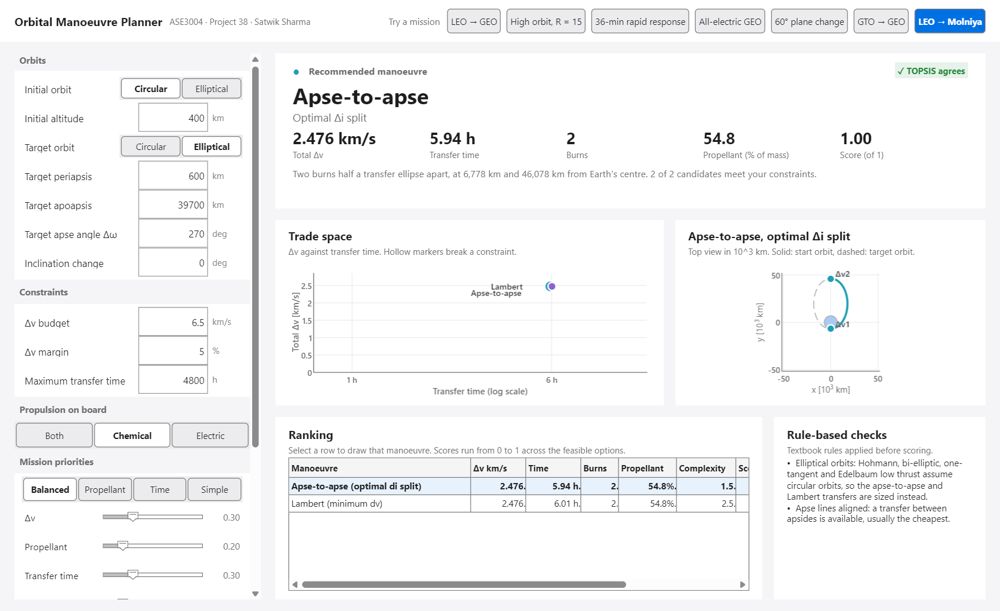
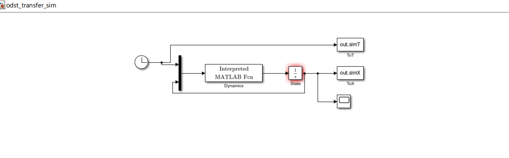
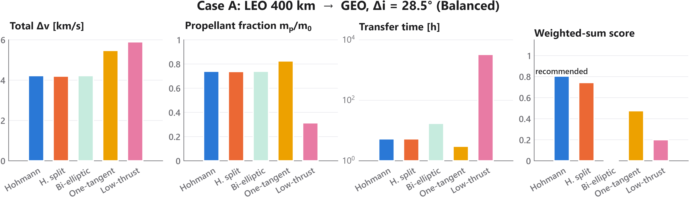
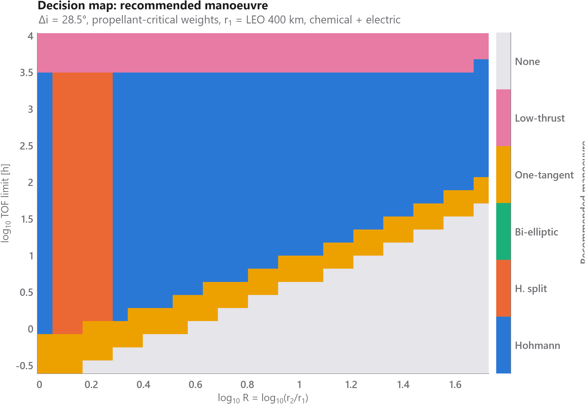
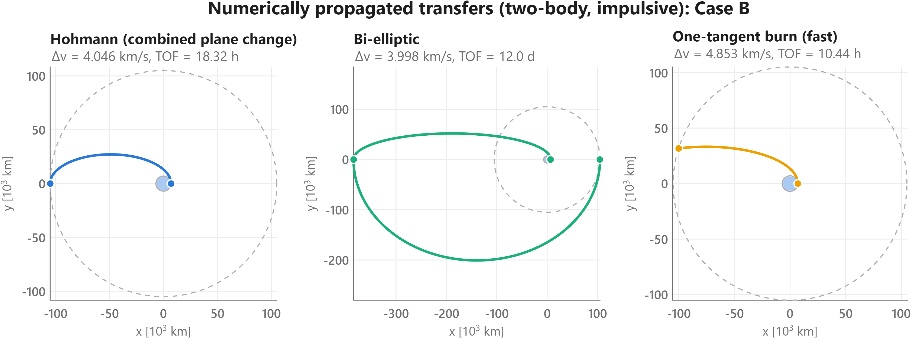
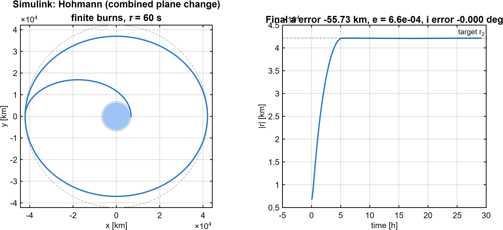

# Orbital Manoeuvre Decision Support Tool

[](https://github.com/satwiksharma01/orbital-manoeuvre-decision-support/actions/workflows/tests.yml)

**Which manoeuvre should a mission fly?** A decision-support tool that sizes the candidate orbital transfers, optimises each one numerically, removes those that break the mission's constraints and ranks the rest by the mission's priorities. Five transfers between circular orbits; apse-to-apse and Lambert transfers when either orbit is elliptical. Orbits are given by an inclination change, or by each orbit's inclination, RAAN and argument of periapsis; the vehicle by a thrust-to-weight and an acceleration, or as a spacecraft with masses, thrust, power and the propellant on board. Optionally, a Monte Carlo over Isp, thrust and pointing errors gives each option's chance of fitting the limits, and with orbital elements J2 can be switched on: the transfers then aim for the target's plane as J2 will have turned it, and a nodal drift lets J2 close a gap in RAAN while the spacecraft waits in a parking orbit. Built in MATLAB and Simulink, cross-checked in Python and NASA GMAT, with an interactive web planner.



**[Try the live demo](https://satwiksharma01.github.io/orbital-manoeuvre-decision-support/web/)**

## What it does

Given an initial and a target orbit (circular, or elliptical with a periapsis and an apoapsis), their orientation (an inclination change and the target's apse angle Δω, or each orbit's inclination, RAAN and argument of periapsis), a Δv budget, a time limit, the propulsion on board, the vehicle (a thrust-to-weight and a low-thrust acceleration, or a spacecraft's wet mass, chemical thrust, electric power and efficiency, and propellant on board), the gravity (two-body, or J2 with orbital elements) and the mission's priorities, the tool:

1. **Models the candidates.** Between circular orbits: Hohmann, Hohmann with an optimised plane-change split, bi-elliptic, one-tangent burn and an Edelbaum low-thrust spiral. When either orbit is elliptical: an apse-to-apse transfer with an optimised plane-change split, and the minimum-Δv two-burn Lambert transfer. Orbital elements are turned into what the models need: the angle between the planes, and each periapsis measured from the node line where the planes cross.
   With J2 on, the nodes and apse lines drift at J2's secular rates. Each impulsive transfer aims for where the target's plane and apse line will be when it arrives, and the spiral adds low-thrust plane changes at the target orbit for the drift it leaves. Between circular orbits a sixth transfer is offered, the **nodal drift**: a Hohmann transfer to a parking orbit, a wait while the two planes' different drift brings their nodes together, and a Hohmann transfer on to the target with the inclination change on the shared node line.
2. **Optimises each one:** the plane-change split (`fminbnd`), the bi-elliptic apoapsis under a time limit (grid search + `fminbnd` + `fzero`), the cheapest fast transfer that meets a deadline (`fzero`), and the Lambert transfer over departure point, arrival point and flight time (a universal-variable Lambert solver inside a grid search, golden section and Nelder–Mead). Lambert arcs are kept at least 100 km above the surface. The nodal drift's parking orbit is the cheapest that meets the time limit, found on a grid and refined by bisection to the limit.
3. **Applies rules:** hard constraints (Δv plus a finite-burn gravity-loss estimate and a margin, default 5 %, time, propulsion, and with a spacecraft the propellant on board) plus textbook rules such as the 11.94 / 15.58 Hohmann vs bi-elliptic thresholds for coplanar transfers. The propellant includes the gravity loss. With a spacecraft, the electric thrust follows from the power, F = 2ηP/vₑ, and stays constant as the mass falls, so the spiral speeds up.
   With uncertainty on, each option that meets the limits is flown 4,000 times with random Isp, thrust and pointing errors (1σ, default 1 %, 2 % and 0.5° per axis). Each burn is trimmed straight after it, at the cost of its error. An option that fits the limits in fewer than the required share of the runs (default 90 %) is ruled out. Python, MATLAB and the web draw the same runs, from L'Ecuyer's MRG32k3a with a fixed seed, so they give the same chances.
4. **Ranks the survivors:** weighted-sum scoring cross-checked with TOPSIS, with presets for balanced, propellant-critical, time-critical and low-complexity missions. The trade-space chart plots propellant against time and joins the Pareto front: the options no other beats on both, whatever the weights.
5. **Exports the chosen transfer to NASA GMAT:** a script that flies its burn plan from the start state and reports the orbit it arrives on, plus a JSON file of the burn times and inertial Δv vectors. With orbital elements, both are in EarthMJ2000Eq with the orbits as entered. Use the buttons under the transfer diagram in the web planner or the MATLAB app, or `gmat_script` and `burns_json` in `python/odst.py`. With J2, the script flies in GMAT's JGM-2 J2 field with the target orbit alongside, and sets off each burn, in the local velocity frame (VNB), at its apsis, node or time.

## Results

| Mission | Recommendation | Why |
|---|---|---|
| LEO 400 km → GEO, Δi = 28.5° | Hohmann, 4.22 km/s, 5.3 h | Optimal split saves only 25 m/s; stays first until the time weight exceeds 0.86 |
| Same, propellant-critical, 1-year limit | Low-thrust spiral | Propellant fraction 0.31 instead of 0.74 |
| 7 000 → 105 000 km (R = 15) | Hohmann | Bi-elliptic saves 1.2 % Δv but takes 12 days instead of 18 hours |
| 400 → 800 km within 36 min | One-tangent, k* = 1.0098 | Hohmann takes 48 min; root-finding gives the cheapest transfer that arrives in time |
| GTO 250 × 35 786 km → GEO, Δi = 28.5° | Apse-to-apse: one apogee burn, 1.833 km/s | The burn at apogee both circularises and turns the plane. The Lambert search finds the same 1.833 km/s by coasting to apogee first; NASA GMAT's own targeting agrees to 0.05 mm/s |
| LEO 400 km → a Molniya-sized 600 × 39 700 km orbit, Δω = 270° (in the start plane) | Apse-to-apse, 2.476 km/s, 5.9 h | From a circular orbit, any point can be the transfer's perigee. Lambert comes within 1.5 mm/s of it, so the simpler two-burn transfer wins |
| 500 × 5 000 → 800 × 12 000 km, apse lines 60° apart, Δi = 10° | Lambert, 1.859 km/s, 1.0 h | Two elliptical orbits with apse lines 60° apart rule out apse-to-apse; only the Lambert transfer is offered |
| 1,000 kg spacecraft with 500 kg of chemical and 350 kg of electric propellant, LEO → GEO, Δi = 28.5° | Low-thrust spiral, 313 kg of propellant, 114.5 days | Every chemical transfer needs more than 500 kg (758 kg for Hohmann with the margin). 6.5 kW at 60 % efficiency gives 0.50 N; as the mass falls, the spiral takes 114.5 days, not the 136.5 a constant acceleration would |
| LEO → GEO, propellant-critical, 3,300 h limit, with Isp, thrust and pointing errors | Hohmann | Without errors the spiral wins, at 136.5 days. With a 2 % (1σ) thrust error it makes the limit in only 64 % of 4,000 runs (the normal distribution gives 64.0 %), below the 90 % required |
| Kourou GTO 250 × 35 786 km, i = 6°, ω = 178° → GEO (orbital elements) | Lambert, 1.497 km/s, 1.0 h | The apogee is 2° off the equator crossing, so no exact apse-to-apse transfer exists; with ω = 180° it would cost 1.490 km/s |
| 500 km, i = 51.6°, RAAN 0° → 10° (orbital elements), propellant-critical, 16-day limit, J2 on | Nodal drift, 0.304 km/s, 16.0 days | Without J2 the best is a single 1.040 km/s plane change. At 783 km the node drifts 0.63°/day against the target's, so a climb, a 15.9-day wait and a Hohmann transfer back down close the 10° gap for 29 % of the Δv |

## Verification

- Textbook benchmarks (Hohmann LEO→GEO 3.893 km/s, the 11.94 bi-elliptic threshold, plane-change limits).
- Every burn plan propagated with `ode45`: final orbit within 0.5 km, e < 10⁻⁹, Δv matches the model to 10⁻⁵ km/s.
- **Simulink** finite-burn model: the error grows as τ², about 56 km at τ = 60 s for LEO→GEO, so the impulsive model holds for short chemical burns.
- An independent Python implementation and a Node test of the web engine agree with MATLAB to every printed digit.
- **NASA GMAT R2026a**: GMAT's differential corrector, flying the same LEO 400 km → GEO transfers, matches the tool to under 1 mm/s and 0.01 s (4.22154 km/s and 5.2913 h with Δi = 28.5°; 3.85396 km/s coplanar). Adding J2 in GMAT costs 2.4 m/s more and 1.1 s. Script in `gmat/`, runner `python/gmat_crosscheck.py` (needs a local GMAT, so not in CI).
- **Elliptical orbits and Lambert:**
  - The Lambert solver reproduces Curtis, Example 5.2, to 10⁻⁴ km/s, and its departure velocity, propagated for the hour, reaches the target position within 10⁻⁶ km.
  - Apse-to-apse between circular orbits equals Hohmann with the optimal split to 10⁻⁹ km/s.
  - Python, MATLAB and the web engine run the same algorithms and agree on four elliptical test missions: Δv to 5 × 10⁻¹⁰ km/s and the same recommendation.
  - Every elliptical burn plan, propagated, arrives on its target orbit with angular-momentum and eccentricity-vector errors around 10⁻¹¹.
  - In GMAT, the differential corrector solves the GTO → GEO apogee burn itself (1.83334 km/s, within 0.05 mm/s of the tool). GMAT also flies all six elliptical burn plans, including a 3D Lambert transfer, from the exported scripts, and every arrival matches the target orbit to 3 × 10⁻¹¹.
- **GMAT export:**
  - GMAT runs the exported scripts of 21 transfers from ten missions, circular and elliptical, and arrives on the target orbit to 1.1 × 10⁻⁹ or better.
  - The scripts set GMAT's Earth μ to the tool's value. GMAT's default, 7.5 × 10⁻¹⁰ lower, moved the arrival of a 10-day bi-elliptic plane change by e = 2.6 × 10⁻⁵ (0.2 km).
  - Circular transfers' burn plans coast with an analytic Kepler propagator, which matches Kepler's equation to 10⁻¹¹. Propagated numerically, each plan reaches its target orbit at exactly the closed-form Δv.
  - In all three engines, every exported script and JSON file reads back to the exact plan. On 271 random missions every engine's plan flies onto its target to 10⁻¹⁰; plans without an optimised parameter agree across engines to 10⁻¹³ km/s, optimised ones to 4 × 10⁻⁷ km/s.
- **Orbital elements:**
  - Elements that put the start orbit in the reference plane give exactly the Δi inputs' results, and turning both orbits together changes nothing (to 10⁻⁹ km/s).
  - A RAAN change alone matches the spherical-trigonometry angle 2 asin(sin i sin(ΔΩ/2)) between the planes and the closed-form plane-change Δv, to 10⁻¹² (7.833° for ΔΩ = 10° at i = 51.6°).
  - Every burn plan, turned into EarthMJ2000Eq and propagated, arrives on the target given by its own elements: the angular-momentum and eccentricity vectors, so the plane and the apse line count, not only the shape.
  - GMAT runs 28 exported scripts, four given by elements, and arrives on the target plane and apse line to 10⁻⁹ or better; GMAT's own reported inclination and RAAN equal the entered ones.
  - On 331 random missions, 60 of them given by elements, the three engines give the same options, feasibility and recommendation. In one time-limited case with a 109° plane change, the engines' last-bit differences in the derived angles send the Lambert search to different local minima, 11.5 m/s apart (see the Lambert search limitation).
- **Spacecraft model:**
  - A spacecraft whose thrust gives T/W 0.5 reproduces every chemical option of the generic inputs to 10⁻⁹.
  - The constant-thrust spiral: Edelbaum's averaged equations, integrated in time with the mass falling and the yaw law written in the velocity increment, reach GEO speed to 10⁻⁸ km/s and the 28.5° plane change to 10⁻⁶° at the closed-form time; the mass left equals e^(−Δv/vₑ). With Isp → ∞ the time becomes the constant-acceleration one.
  - The propellant limit flips exactly at the propellant needed with the margin (feasible with 10⁻⁶ kg more on board, not with 10⁻⁶ kg less).
  - In GMAT, the exported script carries the spacecraft and a tank that every burn draws from: the propellant GMAT uses equals the tool's to 10⁻⁶ kg on five transfers.
  - On 371 random missions, 40 of them spacecraft, the three engines give the same options, feasibility and recommendation, and the propellant to 3 × 10⁻⁵ kg.
- **Uncertainty (Monte Carlo):**
  - The generator reproduces MRG32k3a's published test vector in all three engines, and its 32,000 normal draws pass a Kolmogorov–Smirnov test against N(0, 1) (p = 0.35).
  - Against closed forms, each within 3 standard errors of 4,000 runs:
    - pointing errors alone on Hohmann against the Rayleigh distribution, by quadrature (80.6 % against 80 %);
    - an Isp error alone against the normal tail (73.7 % against 75 %);
    - a thrust error alone against the normal tail (60.1 % against 60.0 %).
  - All errors together agree with a 400,000-run Monte Carlo from a different generator (numpy's PCG64) to 0.23 of the 3σ band.
  - Hohmann burns turned 3° and 2° off course, each trimmed, arrive on target to 10⁻¹¹, and the trims cost exactly 2 Δv sin(θ/2). In GMAT, three Monte Carlo runs at 2° pointing on five transfers arrive on target to 10⁻¹¹ and use the propellant the tool predicts, to 10⁻⁶ kg.
  - With the errors set to zero, every feasible option fits in every run and nothing changes.
  - On 431 random missions, 60 of them with uncertainty, the three engines give the same chance, run for run, for all 109 options with one. They also agree on the Pareto fronts, feasibility and recommendations. On those 60 missions the required chance rules out 61 options and changes 29 recommendations.
- **J2:**
  - The secular rates give the sun-synchronous inclination at 700 km, 98.19° (Wertz), and no apse-line drift at the critical inclination, 63.435°. Propagated numerically with full J2, three circular orbits' nodes drift at the formula's rate to 0.2 %.
  - J2 off, an inclination change alone or an equatorial target leaves every option unchanged.
  - The spiral's drift, integrated from Edelbaum's averaged equations with J2, matches the tool's quadrature to 10⁻⁶°, and after its plane-change corrections the spiral arrives within 0.0003° of the target's plane. At 10⁻⁴ m/s², where J2 turns the planes apart faster than the spiral can follow, it isn't offered.
  - Flown with full J2 and the target alongside, in Python and in GMAT's JGM-2 field, the nodal drift arrives 0.06–0.14° from the target's plane, under 1.4 % of the plane change it replaces. The rest is J2's effect within each orbit, which the secular rates leave out.
  - Aimed transfers, flown the same way: descents from 20,200 km and from GEO height to an inclined LEO arrive 0.02° and 0.05° from the target's plane in GMAT, where the two-body plans miss by 0.42° and 0.77°.
  - On 539 random missions, 108 of them with J2, the three engines give the same options, feasibility, chances and recommendations. On the J2 missions Δv agrees to 2 × 10⁻⁹ km/s (Lambert 1.4 × 10⁻⁷) and the nodal drift's parking orbit to 4 × 10⁻¹² km.
- **Independent audit (2026-10-22)**, with methods unlike the engines' own:
  - The Lambert solver matches a shooting solution (numerical propagation plus root-finding) on 60 random 3D transfers, short and long way, elliptic and hyperbolic, to 2 × 10⁻¹⁰ km/s.
  - **Ground clearance:** without a check, 7 of 120 time-limited missions between low-perigee orbits produced Lambert "optima" that passed up to 609 km *below* the surface. Every Lambert arc must now stay above 100 km altitude. The floor is an exact penalty, because a hard wall stopped the search short of the boundary (46 m/s high). On a case where the floor is active, the result matches the global optimum from differential evolution to 0.4 mm/s and sits on the floor.
  - The Lambert optimiser reaches the global minimum found by differential evolution on eight missions; on the hardest it beats it by 4 m/s. Transfers in the opposite direction, searched separately for plane changes up to 170°, are never cheaper.
  - Edelbaum's closed form matches its averaged equations integrated numerically with Edelbaum's yaw law: speed to 10⁻⁸ km/s, plane change to 10⁻⁶° (now a permanent test).
  - The gravity-loss estimate stays within 3 % of a numerical finite burn at the perigee of eccentric orbits, not only from circular ones.
  - 271 random missions give the same options, feasibility and recommendation in all three engines; Δv differs by at most 4 × 10⁻⁸ km/s.

| MATLAB GUI | Simulink model |
|---|---|
|  |  |






## Scope and limitations

This is an early trade-study and teaching tool: it tells you which family of transfer to fly, roughly what Δv it costs and roughly how long it takes. It is not a mission-analysis or operations tool. It assumes:

| Assumption | What it leaves out |
|---|---|
| Elliptical orbits get two models | Hohmann, bi-elliptic, one-tangent and low thrust are sized only between circular orbits. Elliptical missions get apse-to-apse and Lambert |
| Lambert is single-revolution and starts at once | Multi-revolution transfers, and waiting or phasing time before departure |
| The Lambert search is a grid plus local refinement, not a proof of the global optimum | With no time limit it matched differential evolution on every audit mission. With a binding time limit to a low-perigee orbit it can land up to 0.35 % above the best transfer found (7 m/s in 3 of 12 hard cases; 24 m/s on a 109° plane change), and there the three engines can stop in different local minima |
| Apse-to-apse needs aligned apse lines | If both orbits are elliptical and their apse lines aren't 0° or 180° apart, or a plane change would need a burn off the node line, only Lambert is offered; there is no three-burn nodal transfer |
| Two-body gravity unless J2 is on | Drag below about 500 km, the higher harmonics, the Moon and the Sun. J2 needs each orbit's own inclination, so it is offered only with orbital elements; without it, RAAN drifts by degrees a day in LEO, which matters for long spirals |
| J2 is secular | The nodes and apse lines turn at J2's orbit-averaged rates. Its effect within an orbit (of order J2 (R/p)², up to about 0.1° on a single-revolution transfer) is left out, and mean and osculating elements aren't told apart (0.4 % in the node rate at the start radius). Aiming helps where the target's drift dominates, as on a descent to LEO; on a climb from LEO the spacecraft's own drift during the transfer leaves about 0.08° either way. Elliptical transfers re-run the Lambert search once for the aim. The nodal drift's parking orbit stays above 300 km, as drag isn't modelled. The spiral starts at once, and isn't offered when J2 turns the planes apart faster than it can follow |
| Burns are impulsive, with a gravity-loss estimate | The loss uses Robbins' approximation from the thrust-to-weight (the input, default 0.5, or the spacecraft's thrust and mass). It matches a fixed-attitude finite burn within 5 % for T/W ≥ 0.2, overestimates a velocity-tracking burn about 2×, and underestimates below T/W ≈ 0.1 |
| Burn timing is ignored | Phasing, rendezvous and launch windows |
| Low thrust is Edelbaum with a steady thrust | Without the spacecraft model the acceleration is constant; with it the thrust follows from the power and stays constant as the mass falls. Eclipses, power that fades with distance or age, and thruster duty cycles are left out. The closed form holds only up to Δi = 114.6° (2 rad), so low thrust isn't offered for larger plane changes |
| Uncertainty is an optional, first-order Monte Carlo | Isp, thrust and pointing errors are independent and normal. Each burn is trimmed straight after it, at the cost of its error; later, cheaper corrections aren't modelled. Burns end at their planned Δv (accelerometer cutoff), so the thrust error changes only the gravity loss and the low-thrust time. Pointing errors of the low-thrust spiral are left out, as their cost is second order. The Δv margin still applies in every run. With 4,000 runs, a chance of 90 % is known to ±0.5 % (1σ) |
| The GMAT export has no real epoch | With orbital elements the script holds the orbits as entered; with an inclination change, the tool's frame (start orbit in GMAT's X-Y plane). Either way the epoch is arbitrary and the spacecraft starts at the departure point, as timing isn't modelled. Low thrust has no impulsive burns, so it isn't exported |
| Weights are chosen by the user | Only the time weight is swept; other weights can flip the ranking |

Within these assumptions the results match NASA GMAT (see Verification).

## Run it

**MATLAB** (R2021a+, Simulink optional), from the `matlab` folder:

```matlab
odst_tests   % validation suite
odst_main    % case studies, figures (matlab/results) and the Simulink check
odst_app     % interactive planner
```

**Web:** open `web/index.html` in any browser. No build step and no dependencies.

**Python** (3.10+, `numpy scipy matplotlib`):

```bash
python python/validate.py        # cross-check
node web/test_engine.js          # web engine regression test
python python/gmat_crosscheck.py # cross-check against a local NASA GMAT install
```

## Repository layout

| Path | Contents |
|---|---|
| `matlab/` | Models, optimisers, decision pipeline (`odst_evaluate.m`), GUI, Simulink model and builder, tests |
| `python/` | Reference implementation, validation and figure scripts |
| `web/` | Self-contained web planner and its engine test |
| `gmat/` | GMAT script for the cross-check, filled in and run by `python/gmat_crosscheck.py` |
| `assets/` | Screenshots and result figures used in this README |
| `tools/` | `record_demo_gif.py`: re-records `assets/demo.gif` from the web planner (Selenium + Edge) |
